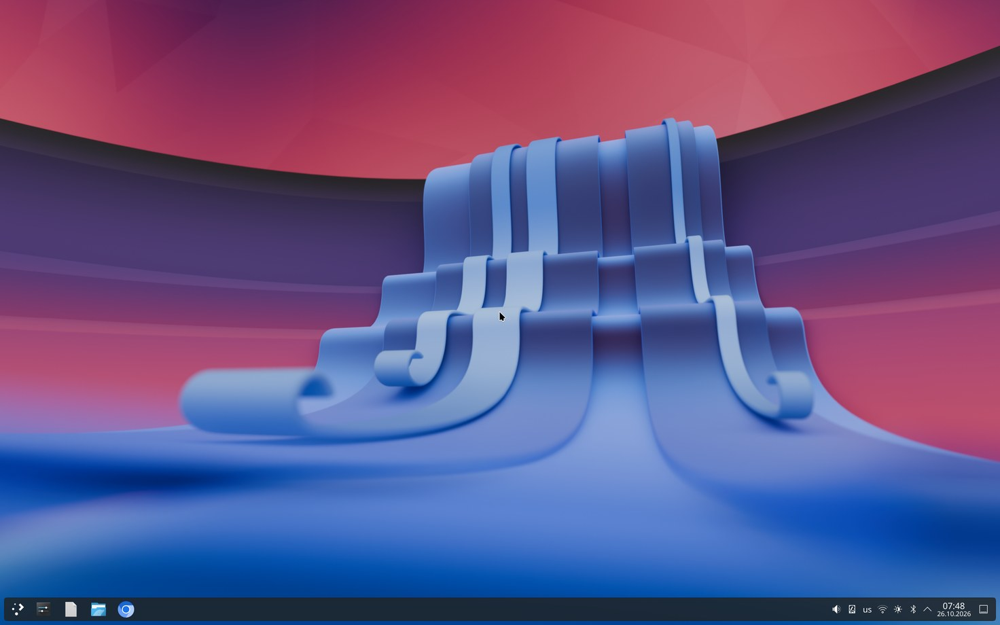
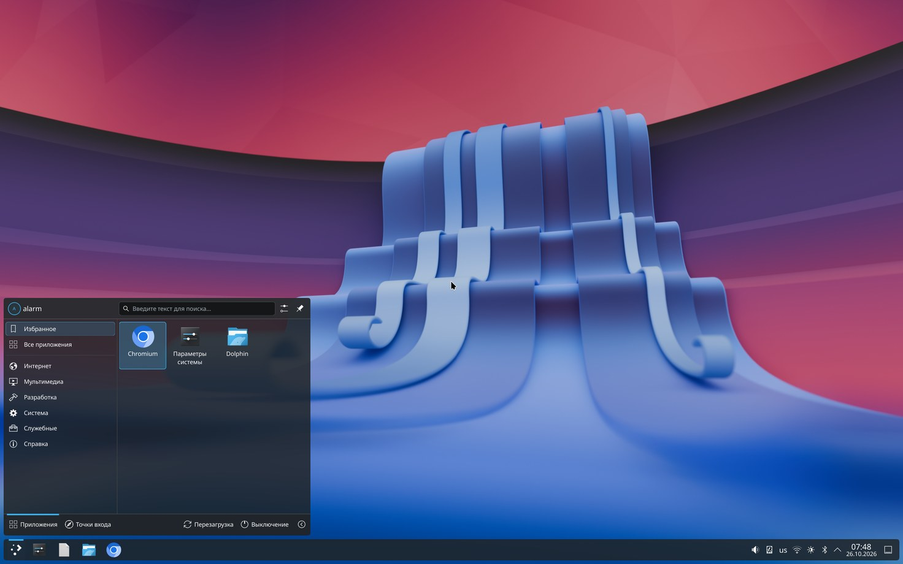
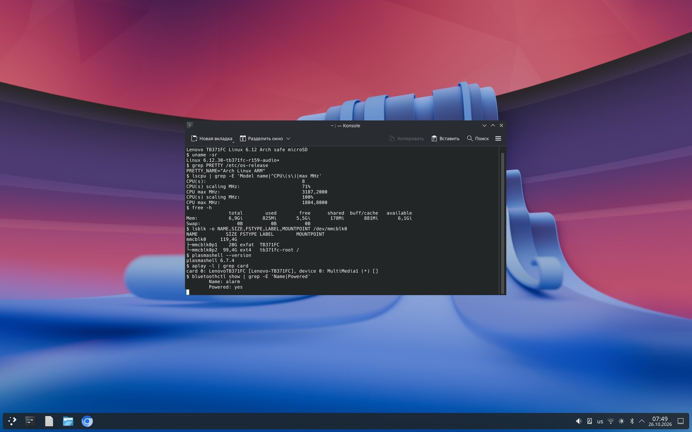
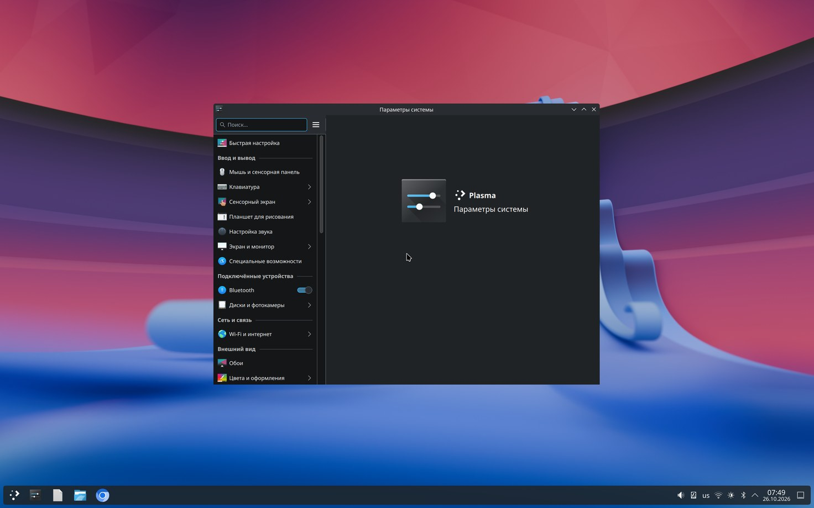

# Lenovo TB371FC (Xiaoxin Pad Pro 12.7, Snapdragon 870 / SM8250) · Linux 6.12

**Русский** · [English](README.en.md)

Arch Linux ARM с KDE Plasma на планшете Lenovo **TB371FC** с ядром **Linux 6.12**,
которое запускается с microSD. Android на встроенной памяти (UFS) не трогается:
Linux целиком живёт на карте и стартует через второй слот recovery (`recovery_b`).

> ⚠️ **Статус: экспериментальный / исследовательский проект.** У автора работает
> каждый день, но для установки нужен разблокированный загрузчик, умение собирать
> ядро Linux и работать с `fastboot`. Планшет можно временно «окирпичить».
> Всё — на ваш страх и риск.

## Скриншоты

| | |
|---|---|
|  |  |
| Рабочий стол KDE Plasma | Меню приложений |
|  |  |
| Терминал: ядро, CPU, память, разметка microSD, звук, Bluetooth | Параметры системы |

*Скриншоты сняты на самом планшете (2944×1840, уменьшены) чтением видеобуфера — `scripts/r184-fbgrab/`.*

## Что работает

| Что | Статус |
|---|---|
| Загрузка Linux 6.12 с microSD (автозагрузка, Android не тронут) | ✅ |
| Рабочий стол KDE Plasma 6 (Wayland), русский/английский, экранная клавиатура | ✅ |
| Сенсорный экран (NT36532) | ✅ |
| Wi-Fi (QCA6390, ath11k) через NetworkManager | ✅ |
| Bluetooth (QCA6390 по UART6) | ✅ |
| Динамики (4 × TFA9894), PipeWire | ✅ |
| Подсветка (два KTZ8866), регулировка яркости | ✅ |
| Постоянная корневая ФС на втором разделе microSD (ext4) | ✅ |
| microSD: DMA, UHS SDR50 — чтение ~46 МБ/с, запись ~32 МБ/с | ✅ |
| Частоты CPU, тепловое ограничение | ✅ |
| Батарея: уровень заряда, ёмкость, циклы (датчик MM8013), значок в KDE | ✅ |
| Подкачка zram (3,5 ГБ сжатой памяти) | ✅ |
| Ограничение заряда батареи (по умолчанию 80/75%, `/etc/tb371fc/chglimit.conf`) | ✅ |
| Микрофоны | ❌ |
| Рабочий стол через ~11 с после старта Linux; песочница Chromium (USER_NS + PID_NS + seccomp) | ✅ |
| USB-C: только USB 2.0 в режиме устройства (связь с ПК); хост-режим (флешки, хабы), USB 3 и вывод изображения — ещё нет | ❌ |
| Chromium на GPU (WebGL, растеризация); видео 1080p плавно — 1,5–3% пропущенных кадров (без GPU 26%) | ✅ |
| Аппаратное декодирование видео (Venus) | ❌ |
| GPU Adreno 650 (freedreno, OpenGL 4.6) — аппаратный композитинг KWin | ✅ |
| Экран: кадровый буфер от загрузчика (simpledrm, 60 Гц) | ⚠️ |
| Родной драйвер дисплея DPU/DSI, 120 Гц | ❌ в работе (левая половина правильная, правая — шум) |
| Запись на microSD в режиме SDR104 | ❌ (чтение работает; нужна подстройка BH201) |
| Камеры, сон, пого-разъём клавиатуры | ❌ / не проверялось |

## Как это загружается

```
включение ─► загрузчик ABL ─► слот recovery_b
                                │  ядро Lenovo 4.19 + наш ramdisk («начальная консоль»)
                                │  · USB-консоль / SSH для ПК (172.31.77.2)
                                │  · 60 с ожидания, если подключён ПК, иначе ~7 с
                                ▼
          microSD p1 (exFAT): tb371fc-linux/autoboot-6.12-rNNN/{Image, board.dtb, initramfs.cpio.gz, ENABLE}
                                │  проверка SHA-256, запуск через kexec (только в ОЗУ)
                                ▼
          initramfs Linux 6.12 ─► монтирует microSD p2 (ext4, метка tb371fc-root) на запись как /
                                ▼
                        systemd ─► NetworkManager, Bluetooth, PipeWire ─► KDE Plasma
```

* Удалите файл `ENABLE` на p1 — автозагрузка отключится, планшет останется в консоли.
* Параметр `tb371fc.maint` в командной строке 6.12 включает **режим обслуживания**:
  корневой раздел не монтируется, по USB доступна аварийная оболочка `172.31.77.2:2323`
  (`scripts/tb371fc-ncm.py`). Через 15 минут без связи планшет сам перезагрузится.
* Android: обычная перезагрузка в штатный слот — в Android ничего не меняется.

## Разметка microSD

| Раздел | ФС | Размер (карта автора 128 ГБ) | Содержимое |
|---|---|---|---|
| p1 | exFAT | 20 ГиБ | `tb371fc-linux/` — образ консоли `tb371fc-arch-development.raw`, наборы автозагрузки, слои |
| p2 | ext4, метка `tb371fc-root` | остальное | корневая ФС Arch Linux ARM (изменения сохраняются) |

Если раздела p2 с меткой `tb371fc-root` нет, загрузчик откатывается на старый режим:
образ только для чтения + слой в ОЗУ (изменения пропадают после перезагрузки).

## Что где в репозитории

| Путь | Что |
|---|---|
| `mainline-port/` | Дерево устройства (`arch/arm64/boot/dts/qcom/sm8250-lenovo-tb371fc.dts`), патчи ядра, конфиг ядра |
| `scripts/build-*.sh` | Сборка ядра и модулей (WSL2 Ubuntu 24.04 или любой Linux, clang 18) |
| `scripts/package-rNNN-*.sh/.py` | Сборка набора автозагрузки и образа recovery для выпуска |
| `scripts/rNNN-sd-install-419.sh` | Запись набора на microSD из консоли 4.19 (с проверкой хешей) |
| `scripts/rNNN-recovery/` | Помощник автозагрузки, который живёт в ramdisk recovery |
| `scripts/r175-loader/` | Загрузчик: постоянный корень на p2, режим обслуживания |
| `scripts/r1xx-config/` | Службы и скрипты, встраиваемые в initramfs (Wi-Fi, BT, настройки рабочего стола…) |
| `scripts/*.ps1` | Инструменты для Windows: прошивка, удержание консоли, перезагрузка, цикл выпуска |
| `initramfs/`, `rootfs/` | Части initramfs и корневой ФС |
| `docs/` | Ранние заметки по порту (панель, звук, тачскрин, recovery, таблица железа…) |

Проект рос выпуск за выпуском (R1 … R183), номер выпуска есть в имени файлов.
Текущий рабочий выпуск — **R188** (батарея, ускорение графики, ядро с USER_NS/PID_NS).

## Установка (обзор)

**Готовых образов в репозитории нет**: образ recovery делается из штатного `recovery_b`
Lenovo, а набор автозагрузки содержит прошивки Qualcomm/Lenovo, которые нельзя
распространять. Их собирают самостоятельно из бэкапа своего планшета.

### 0. Что нужно

* Lenovo TB371FC с **разблокированным загрузчиком** (`fastboot flashing unlock` — стирает данные Android).
* Карта microSD от 64 ГБ (UHS-I, A1/A2).
* ПК с `adb`/`fastboot` (Android platform-tools), Windows 10/11 + WSL2 Ubuntu 24.04
  (скрипты написаны под эту связку) или ПК с Linux.
* Инструменты сборки в WSL/Linux: `clang-18`, `lld`, `make`, `python3`, `cpio`, `mkbootimg`
  (`unpack_bootimg.py`), `avbtool`, `e2fsprogs`, `exfatprogs`.

### 1. Бэкап

Прежде всего снимите штатные разделы (минимум `recovery_a/b`, `vbmeta_a/b`, `boot_a/b`,
`dtbo_a/b`) и сохраните. Скрипты ждут штатный recovery в
`artifacts/device-backup/lun0-recovery_b.bin`. Укажите серийный номер для fastboot:

```powershell
$env:TB371FC_SERIAL = '<серийный номер из "fastboot devices">'
```

### 2. Сборка ядра и модулей

1. Возьмите Linux 6.12 (в проекте 6.12.30) и наложите патчи из `mainline-port/patches/`
   (активные перечислены в `scripts/build-r179-kernel.sh`).
2. Базовый конфиг — `mainline-port/tb371fc-arch.config`.
3. Соберите `Image`, дерево устройства `sm8250-lenovo-tb371fc.dtb` и модули
   (`scripts/build-r174-bh201.sh`, `build-r178-uhs.sh` собирают модули для microSD).

Пути в скриптах по умолчанию — `/mnt/d/TB371FC-builds` и `/root/tb371fc/...`;
поправьте их под свою машину.

### 3. Подготовка microSD

1. Разметка: p1 exFAT (~20 ГиБ), p2 ext4 с меткой `tb371fc-root` (остаток карты).
2. Распакуйте на p2 корневую ФС Arch Linux ARM (aarch64) и поставьте KDE Plasma,
   NetworkManager, bluez, pipewire (см. `docs/ROOTFS.md`, `docs/ARCH_PROFILE.md`).
   Прошивки берутся с вашего же планшета (`scripts/package-stock-firmware.sh`
   извлекает их из штатных разделов; см. `docs/FIRMWARE.md`).
3. Положите образ консоли в `p1:/tb371fc-linux/tb371fc-arch-development.raw`.

### 4. Сборка набора автозагрузки и recovery

```bash
bash scripts/package-r179-autoboot.sh                 # Image + initramfs.cpio.gz (headless GPU)
bash scripts/build-r185-gpu-dt.sh                     # board.dtb: батарея + GPU
bash scripts/build-r187-userns-kernel.sh              # Image: USER_NS + PID_NS
python3 scripts/package-r188-autoboot-recovery.py     # образ recovery_b с помощником автозагрузки
```

Скопируйте набор в `p1:/tb371fc-linux/autoboot-6.12-r188/` вместе с пустым файлом
`ENABLE` (или дайте это сделать `scripts/r188-sd-install-419.sh` из консоли).
На корневую ФС положите файлы из `scripts/r184-config/` (zram, батарея, UPower, GPU — см. комментарии в них).

**Wi-Fi:** ваша сеть прописывается при сборке из файла в формате `wpa_supplicant`,
где есть только **хеш PSK** (вывод `wpa_passphrase` без строки с открытым паролем).
Храните его вне репозитория. **SSH:** создайте свой ключ (`ssh-keygen -t ed25519`)
в `artifacts/tb371fc-development-ssh/` — эта папка в `.gitignore`.

### 5. Прошивка recovery_b

```bash
fastboot flash recovery_b tb371fc-rNNN-recovery.img
fastboot flash vbmeta_b vbmeta-disabled.img      # vbmeta с отключённой проверкой
fastboot reboot recovery
```

`scripts/tb371fc-flash-release.ps1` делает весь цикл сам (консоль → загрузка →
запись на SD → fastboot → ожидание SSH). Никогда не прошивайте `boot`, `userdata`
или слот A, если не понимаете точно, зачем.

### 6. Первая загрузка

Загрузитесь в recovery (`fastboot reboot recovery`, `adb reboot recovery` или пункт
recovery в меню загрузчика). Появится консоль, через несколько секунд автозагрузка
запустит Linux 6.12, затем KDE Plasma (пользователь `alarm`). Раскладка — Alt+Shift;
масштаб, обои, темы настраиваете сами — всё сохраняется между перезагрузками.

### Откат

* Удалите `ENABLE` с p1 (через картридер на ПК) → планшет останется в консоли.
* Прошейте сохранённые штатные `recovery_b`/`vbmeta_b` → всё как было.
* Android ни на одном шаге не затрагивается.

## Благодарности

* [smith-dog/kernel-tb371fc](https://github.com/smith-dog/kernel-tb371fc) — ядро 4.19 сообщества для TB371FC.
* Сообщество mainline для Xiaomi Pad 6 (pipa, PAD6-DEV) — панель nt36532 и работа по планшетам SM8250.
* Проекты Linux, freedreno/Mesa, Arch Linux ARM и KDE.

## Поддержать проект ☕

Если проект вам помог, можно угостить автора кофе:

[](https://boosty.to/slvgb)

**Boosty:** <https://boosty.to/slvgb>

## Лицензия

Патчи ядра и дерево устройства — GPL-2.0 (как ядро Linux). Скрипты и документация —
см. заголовок файла; если не указано иное — GPL-2.0. Прошивки Lenovo/Qualcomm
**не входят** в репозиторий и его лицензией не покрываются.
